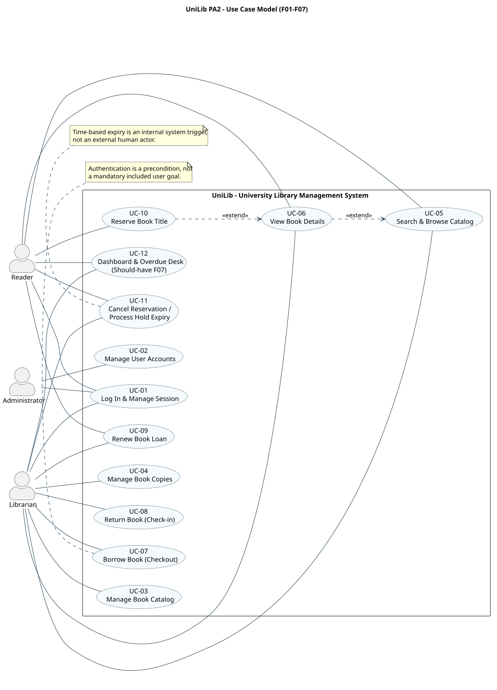

# 6. Use Case Model

**Project:** UniLib | **Phase:** PA2 SRS | **Task:** PA2-Q2
**Author:** Tran Ha Anh Quan (Developer) | **Reviewer:** Nguyen Phan The Vinh (PM/Tester)
**Status:** Ready for team review | **Registry:** pa/PA2/00-id-registry.md v1.0.0-frozen

## 6.1 Actors and system boundary

| Actor | Description | Main privileges |
| --- | --- | --- |
| Reader | Authenticated patron who searches and places title-level reservations. | Search and details, hold requests/cancellation, renewal of own eligible loans, own dashboard. |
| Librarian | Circulation and inventory staff member. | Catalog/copy management, checkout/check-in, renewals, queue/hold desk and overdue monitoring. |
| Administrator | Staff account administrator. | Manage user accounts, roles and active status. |

All three actors can access UC-01. The system boundary contains UniLib application operations only. Automated hold expiry is a time-triggered internal job of UC-11, not a fourth external actor. Application-level role checks are subject to BR-10 and NFR-04.

## 6.2 Diagram

Source: [diagrams/use-case.puml](diagrams/use-case.puml). This source is versioned and is the authoritative diagram-as-code.

## 6.3 Use case inventory and traceability

| Use case | Name | Primary actor(s) | Feature | Frozen requirements | Screen(s) | Priority |
| --- | --- | --- | --- | --- | --- | --- |
| UC-01 | Log In & Manage Session | Reader, Librarian, Administrator | F01 | FR-F01-01 to FR-F01-03 | SCR-01 | Must |
| UC-02 | Manage User Accounts | Administrator | F01 | FR-F01-04, BR-10 | SCR-02 | Must |
| UC-03 | Manage Book Catalog (Titles) | Librarian | F02 | FR-F02-01 to FR-F02-04 | SCR-03 | Must |
| UC-04 | Manage Book Copies & Inventory | Librarian | F03 | FR-F03-01 to FR-F03-04, BR-09 | SCR-04 | Must |
| UC-05 | Search & Browse Catalog | Reader, Librarian | F04 | FR-F04-01 to FR-F04-04 | SCR-05 | Must |
| UC-06 | View Book Details & Availability | Reader, Librarian | F02, F04 | FR-F02-04, FR-F04-03 | SCR-06 | Must |
| UC-07 | Borrow Book (Checkout) | Librarian | F05, F06 | FR-F05-01 to FR-F05-03; FR-F06-06 | SCR-07, SCR-10 | Must |
| UC-08 | Return Book (Check-in) | Librarian | F05, F06 | FR-F05-04, FR-F05-05, FR-F06-04 | SCR-08, SCR-10 | Must |
| UC-09 | Renew Book Loan | Reader, Librarian | F05 | FR-F05-06, BR-03 | SCR-11, SCR-07 | Must |
| UC-10 | Reserve Book Title | Reader | F06 | FR-F06-01 to FR-F06-03 | SCR-09, SCR-06 | Must |
| UC-11 | Cancel Reservation & Process Expiry | Reader, Librarian / time-triggered process | F06 | FR-F06-04, FR-F06-05 | SCR-10, SCR-11 | Must |
| UC-12 | View Reader Dashboard & Overdue Desk | Reader, Librarian | F07 | FR-F07-01 to FR-F07-03 | SCR-11, SCR-12 | Should |

The six starred core use cases in the frozen registry are UC-01, UC-03, UC-05, UC-07, UC-08 and UC-10. The extended team task plan requests a broader set of specifications; the diagram still contains all 12 frozen use cases.

## 6.4 UML relationships

- UC-06 **extends** UC-05: viewing a selected title is an optional continuation after catalog results; searching does not always require opening details.
- UC-10 **extends** UC-06: placing a hold is a conditional action on title details when no copy is available and the Reader is eligible.
- No artificial include relationship is drawn between Login (UC-01) and all protected use cases: an active session is a precondition, not a subflow executed each time.
- Checkout (UC-07) can fulfill a copy already reserved for the same Reader (FR-F06-06); see its alternate flow rather than adding an extra unregistered use case.
- UC-11's cancellation is user-initiated; expiration is a system time event. Both remain one frozen use case, though this compound goal is flagged for review.

## 6.5 Consistency check

The use case list is anchored to the frozen UC-01..UC-12 and SCR-01..SCR-12 registries. All Must-have modules F01..F06 are represented; F07 is explicitly Should. Browser screens are traced by ID, not claimed as visually validated against Figma because access to the linked file was denied during this review.

A naming conflict in the supplied team task plan calls UC-09 "Overdue"; the frozen registry defines UC-09 as **Renew Book Loan**. This document follows the frozen registry without changing IDs. Overdue detection is FR-F05-07 and appears in UC-09 preconditions and UC-12 monitoring.
