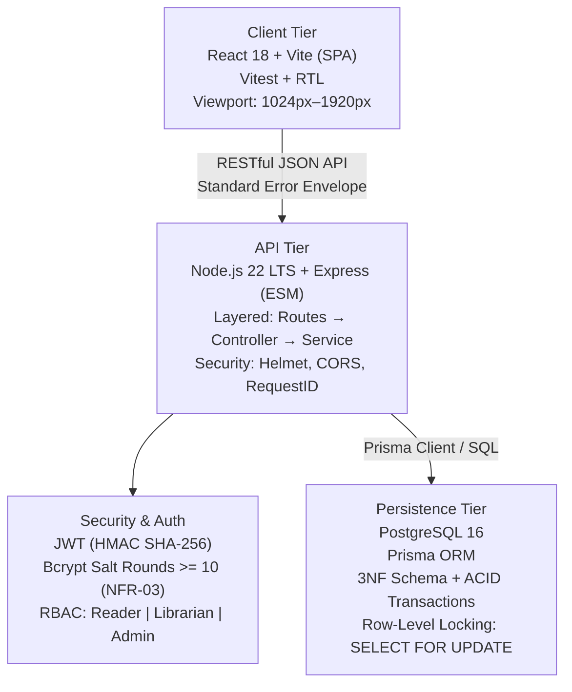

# UniLib — Software Design (PA3)
## §1. Member Contribution Assessment & §2. Design Goals and Constraints

* **Project:** UniLib – University Library Management System
* **Phase:** PA3 — Software Design
* **Document Version:** 1.0.0-draft
* **Authors:** Team T05 (Vinh, Nguyên, Ánh, Quân)
* **Date:** Monday, November 23, 2026
* **Reference Baseline:** SRS PA2 Frozen Baseline v1.0.0 (`pa/PA2/T05-PA2.docx`, `docs/pa2/00-id-registry.md`)

---

# 1. Member Contribution Assessment

## 1.1 Assessment Policy & Governance

In strict accordance with the approved Team Contract (PA0 §3.1, §3.5) and the precedent established in PA1 and PA2:
* **Equitable Workload Target:** All four team members maintain an equal 25.0% contribution commitment (total 100.0%). The total effort for PA3 is budgeted at 60 person-hours across Slots W1–W2 (November 03 – November 28, 2026), representing exactly 15 person-hours per member.
* **Single Ownership & Traceable Accountability:** Every software design artifact (C4 models, ADRs, 3NF database schema, class/sequence diagrams, screen flows, and API specifications) is assigned to a single primary author and an independent peer reviewer.
* **Objective Evidence Requirement:** All contribution claims are substantiated by concrete repository artifacts: assigned GitHub issues on the project board ([UniLib Project Board](https://github.com/users/Vincenthevinh/projects/1)), merged pull requests, verifiable commit histories, and peer review logs.
* **Quality & Deadline Standards:** All deliverables adhere to the internal quality deadline—frozen two days before the course submission gate (Internal baseline freeze: Saturday, November 28, 2026; official deadline: Monday, November 30, 2026).

---

## 1.2 Member Contribution Assessment Table

| Student ID | Member Name | Role(s) in PA3 | Contribution (%) | Assigned Work Packages & Verifiable Evidence | Status & Verification |
| :--- | :--- | :--- | :---: | :--- | :---: |
| **23127520** | **Nguyễn Phan Thế Vinh** | Team Lead / PM · Backend / Tester | **25%** | **Work Packages PA3-V1 to PA3-V4 (15.0h):** • **Task PA3-V1 (W1):** Initialize `src/` skeleton, Express server bootstrap, error handling middleware, health check endpoint, and multi-package CI pipeline ([PR #88](https://github.com/Vincenthevinh/UniLib/pull/88), Issue [#33](https://github.com/Vincenthevinh/UniLib/issues/33)). • **Task PA3-V2 (W1):** Author Section 1 Member Contribution & Section 2 Design Goals and Constraints ([01-contribution-goals.md](01-contribution-goals.md)). • **Task PA3-V3 (W2):** Conduct Requirements-to-Design Traceability update linking all 32 FRs, 8 NFRs, 10 BRs to Architecture Components, DB Tables, and Class Models. • **Task PA3-V4 (W2):** Coordinate PA3 design inspection walkthrough, reconcile AI Usage Log, and compile final `PA3-SoftwareDesign.docx`. | **In Progress** (W1 Completed) |
| **24127469** | **Nguyễn Thanh Thảo Nguyên** | Business Analyst (BA) | **25%** | **Work Packages PA3-N1 to PA3-N4 (15.0h):** • **Task PA3-N1 (W1):** Detail Object-Oriented Domain Model capturing core library entities (`User`, `BookTitle`, `BookCopy`, `Loan`, `Reservation`, `HoldShelf`). • **Task PA3-N2 (W1):** Author Class Specifications for the 6–8 core system classes, including attributes, methods, visibility, and invariants. • **Task PA3-N3 (W2):** Author UML Sequence Diagrams for core Must workflows (`UC-01`, `UC-03`, `UC-05`, `UC-07`, `UC-08`, `UC-10`). • **Task PA3-N4 (W2):** Design State Machine Diagrams for `BookCopy` lifecycle (`Available` $\rightarrow$ `Borrowed` $\rightarrow$ `Reserved` $\rightarrow$ `Damaged`) and `Loan`/`Reservation` states. | **In Progress** (W1 Active) |
| **24127324** | **Vũ Thị Ánh** | UI/UX Designer / Frontend Architect | **25%** | **Work Packages PA3-A1 to PA3-A4 (15.0h):** • **Task PA3-A1 (W1):** Construct comprehensive Screen Navigation Flow Diagram mapping transitions across all 12 screens (`SCR-01` to `SCR-12`). • **Task PA3-A2 (W1):** Author Detailed Screen Specifications (layout regions, input bindings, error state representations, accessibility labels). • **Task PA3-A3 (W2):** Validate Accessibility Checklist against `NFR-06` (contrast $\ge 4.5:1$, visible keyboard focus, responsive layout from 1024px to 1920px). • **Task PA3-A4 (W2):** Build frontend client skeleton (`src/client`) using React + Vite + Vitest, verifying component structure and client routing. | **In Progress** (W1 Active) |
| **24127228** | **Trần Hà Anh Quân** | Fullstack Developer / Tech Lead | **25%** | **Work Packages PA3-Q1 to PA3-Q4 (15.0h):** • **Task PA3-Q1 (W1):** Formulate Architectural Style, C4 Level 1 (Context Diagram), C4 Level 2 (Container Diagram), and Component Diagram. • **Task PA3-Q2 (W1):** Author Architecture Decision Records (ADR-01 Layered Express, ADR-02 PostgreSQL 16 + Prisma, ADR-03 JWT RBAC, ADR-04 Concurrency Row Locking). • **Task PA3-Q3 (W2):** Design 3NF Relational Database Schema, ERD, table DDL, indexing strategy for `NFR-01`, and foreign key constraints for `BR-09`. • **Task PA3-Q4 (W2):** Specify RESTful API endpoint contracts for F01–F06 with request/response schemas, HTTP status codes, and error payloads. | **In Progress** (W1 Active) |
| **Total** | **Team T05 (4 members)** | — | **100%** | **16 PA3 Work Packages across exactly 60 Person-Hours** | **On Track** |

---

## 1.3 Peer Review & Verification Matrix

| Section | Content Description | Primary Author | Designated Reviewer | Verification Scope & Criteria |
| :--- | :--- | :---: | :---: | :--- |
| **§1 & §2** | Contribution & Design Goals | Vinh (PM) | Quân (Tech Lead) | Verify strict adherence to frozen NFR/FR IDs, stack constraints, and 25% equal allocation. |
| **§3** | Architectural Design (C4 & ADRs) | Quân (Tech Lead) | Ánh (Architect) | Validate C4 diagrams, container boundaries, deployment model, and ADR justifications. |
| **§4** | Object-Oriented Design (UML & Classes) | Nguyên (BA) | Vinh (Tester) | Verify class specifications against business rules (`BR-01` to `BR-10`) and sequence completeness. |
| **§5** | Data Design (ERD & 3NF Schema) | Quân (Tech Lead) | Nguyên (BA) | Audit 3NF normalization, foreign key integrity (`BR-09`), indexes for `NFR-01`, locking for `NFR-05`. |
| **§6** | UI/UX Design & Screen Flow | Ánh (Designer) | Nguyên (BA) | Confirm screen navigation flow matches Use Case paths (`UC-01` to `UC-12`) and accessibility `NFR-06`. |
| **§7 & §8**| Traceability Update & AI Log | Vinh (PM) | All Members | Audit 100% forward traceability from SRS PA2 to PA3 models; consolidate team AI logs. |

---

# 2. Design Goals and Constraints

The architectural and detailed design of UniLib is driven directly by the architecturally significant requirements established and frozen in the Software Requirements Specification (PA2 Baseline v1.0.0).

---

## 2.1 Non-Functional Requirements Registry (NFR-01 to NFR-08)

All 8 Non-Functional Requirements from PA2 are incorporated as strict design goals:

| NFR ID | Category | Measurable Requirement & Conditions (Frozen PA2 Baseline) | Architectural Realization & Verification Method |
| :--- | :--- | :--- | :--- |
| **`NFR-01`** | **Performance (Search)** | Under a load of 100 concurrent simulated users, catalog search queries shall return response payloads in $\le 1.0$ second at P95 across 10,000 seeded book records. | **Database Indexing & Server-Side Pagination:** B-tree indexes on `isbn`, `category`, and composite trigram/gin index on `(title, author)`. Paginated API queries with default limit of 10 records. Verified via automated k6 load test scripts. |
| **`NFR-02`** | **Performance (Page Load)** | Initial application load time shall achieve Largest Contentful Paint (LCP) $\le 2.5$ seconds at P90 on standard broadband / 4G network profiles. | **Vite Bundle Optimization & Lazy Loading:** Code splitting with dynamic `import()`, compressed static assets, minimal vendor bloat. Verified via Google Lighthouse Performance Audit. |
| **`NFR-03`** | **Security (Password Hashing)** | User passwords shall be hashed using bcrypt with salt rounds $\ge 10$ prior to database persistence; plain-text credentials shall never be logged or transmitted in response payloads. | **Cryptographic Hashing:** Node.js `bcrypt` implementation with 10 salt rounds before storage. User entity DTOs explicitly omit password fields in responses. Verified via unit and integration tests. |
| **`NFR-04`** | **Security (Authorization)** | All protected REST API endpoints shall validate JWT claims; unauthenticated requests shall return HTTP 401 Unauthorized; unauthorized roles shall return HTTP 403 Forbidden. | **JWT Authentication & RBAC Middleware:** Express middleware verifies asymmetric/secret HMAC signature and extracts `userId` and `role` (`READER`, `LIBRARIAN`, `ADMINISTRATOR`). Enforced at router level. Verified via Supertest test suites. |
| **`NFR-05`** | **Data Integrity (Concurrency)** | Circulation state transitions (checkout, check-in, hold allocation) shall execute within atomic database transactions with row-level locks (`SELECT FOR UPDATE`), guaranteeing 0 race conditions or duplicate loan/hold states under concurrent requests. | **Pessimistic Row-Level Locking:** PostgreSQL atomic transactions (`BEGIN ... COMMIT`) utilizing `SELECT ... FOR UPDATE` on `BookCopy` records during checkout and hold fulfillment to prevent double-checkout races. Verified via concurrent test scripts. |
| **`NFR-06`** | **Usability & Accessibility** | The user interface shall achieve a Google Lighthouse Accessibility score of $\ge 85$, maintain a minimum color contrast ratio of 4.5:1 for normal text, and support full keyboard navigation across form controls. | **Semantic HTML & WCAG 2.1 AA Compliance:** High-contrast design palette, explicit `aria-label`, visible keyboard `:focus-visible` styling, logical tab order. Verified via Lighthouse Accessibility Audits. |
| **`NFR-07`** | **Compatibility** | The web application shall render correctly and maintain responsive layout integrity across modern evergreen desktop browsers (Chrome 120+, Firefox 120+, Edge 120+, Safari 17+) on viewport widths from 1024px to 1920px. | **Responsive CSS Grid/Flexbox Layouts:** Modern CSS standard resets without vendor-specific hacks, CSS media queries targeting 1024px, 1280px, 1440px, and 1920px viewports. Verified via cross-browser browser emulation. |
| **`NFR-08`** | **Reliability & Graceful Error Handling** | In the event of network failure or backend service unavailability, the frontend application shall display user-friendly error banners without crashing, and system shall support full database schema restoration via seed scripts in $< 5$ minutes. | **Centralized Error Boundary & Seed Scripts:** Express centralized `errorHandler` returning structured `{ error: { code, message, details } }` with zero stack trace leakage. Frontend Axios/Fetch interceptor showing alert banners. Deterministic SQL/Prisma seed scripts. Verified via fault injection and timed restore runs. |

---

## 2.2 High-Priority Functional Requirements (F01–F06 Must-Have + F07)

The software design prioritizes the mandatory Must-have features required for PA5 implementation:

### 1. F01: User Authentication & Role-Based Access Control (Must)
* `FR-F01-01`: Credential authentication via username/email and password (`SCR-01`, `UC-01`).
* `FR-F01-02`: JWT token generation, claims validation, and RBAC across Reader, Librarian, and Administrator endpoints.
* `FR-F01-03`: Client session invalidation upon secure logout.
* `FR-F01-04`: Administrator capabilities for user account creation, role assignment, and status deactivation (`ACTIVE`/`INACTIVE`) (`SCR-02`, `UC-02`).

### 2. F02: Book Catalog Management (Must)
* `FR-F02-01`: Librarian creation of book title metadata: unique ISBN, Title, Author, Category, Publisher, Year (`SCR-03`, `UC-03`).
* `FR-F02-02`: Librarian metadata editing for existing catalog entries.
* `FR-F02-03`: Deletion/deactivation blocked if active physical copies, loans, or holds exist (`BR-09`).
* `FR-F02-04`: Real-time aggregated copy counters (Total, Available, Borrowed, Reserved) on detail views (`SCR-06`, `UC-06`).

### 3. F03: Book Copy Inventory Management (Must)
* `FR-F03-01`: Registration of physical copies with unique Barcode ID and Shelf Location (`SCR-04`, `UC-04`).
* `FR-F03-02`: Update of shelf location and physical condition notes.
* `FR-F03-03`: Lifecycle state machine enforcement: `Available`, `Borrowed`, `Reserved`, `Damaged`/`Lost`.
* `FR-F03-04`: Decommissioning allowed only for `Available` or `Damaged`/`Lost` copies; deletion blocked for `Borrowed` or `Reserved` copies (`BR-09`).

### 4. F04: Book Search & Browse (Must)
* `FR-F04-01`: Multi-attribute keyword search across Title, Author, Category, and ISBN (`SCR-05`, `UC-05`).
* `FR-F04-02`: Dynamic filtering by Category and Availability Status (`Available Now` vs `All`); sorting by Title or Year.
* `FR-F04-03`: Real-time copy availability badges and shelf location display (`SCR-05`, `SCR-06`).
* `FR-F04-04`: Server-side pagination with configurable page size (default 10 items/page, `NFR-01`).

### 5. F05: Borrow & Return Management (Circulation Desk) (Must)
* `FR-F05-01`: Librarian issuance of book loans linking active Reader ID and `Available` Copy ID (`SCR-07`, `UC-07`).
* `FR-F05-02`: Eligibility verification: $< 3$ active loans (`BR-01`) and 0 overdue loans (`BR-04`).
* `FR-F05-03`: Automatic due date calculation exactly 14 calendar days from checkout (`BR-02`) and status transition to `Borrowed`.
* `FR-F05-04`: Book check-in by scanning Copy ID, logging return timestamp, setting loan to `Returned` (`SCR-08`, `UC-08`).
* `FR-F05-05`: Hold queue evaluation on return: if pending holds exist, transition copy to `Reserved` for top FIFO patron (`BR-08`); otherwise transition to `Available`.
* `FR-F05-06`: Loan renewal extending due date by 14 days exactly once (`BR-03`), provided 0 overdue loans and 0 reservations.
* `FR-F05-07`: Automated overdue detection when current calendar date exceeds designated due date.

### 6. F06: Book Reservation (Hold Processing) (Must)
* `FR-F06-01`: Reservation allowed if and only if exactly 0 physical copies are in `Available` status (`BR-05`, `SCR-09`, `UC-10`).
* `FR-F06-02`: Reservation constraints: maximum 2 active reservations per reader (`BR-06`); blocked if user currently borrows the title.
* `FR-F06-03`: Automated First-In, First-Out (FIFO) queue ordering per book title (`BR-07`).
* `FR-F06-04`: Hold shelf pickup window of exactly 72 hours (3 calendar days) upon copy arrival (`BR-08`, `SCR-10`).
* `FR-F06-05`: Reservation cancellation by reader, and automatic expiration after 72 hours advancing hold to next reader or releasing to `Available` (`UC-11`).
* `FR-F06-06`: Fulfillment of reservation upon checkout at the circulation desk.

### 7. F07: Reader Overdue & Loan Monitoring Dashboard (Should)
* `FR-F07-01`: Reader self-service dashboard for active loans, due dates, renewal actions, reservations, and queue positions (`SCR-11`, `UC-12`).
* `FR-F07-02`: Visual overdue alerts and borrowing restriction banners.
* `FR-F07-03`: Librarian overdue monitoring console with days overdue and patron contact details (`SCR-12`, `UC-12`).

---

## 2.3 Architectural & Technology Constraints

The system design strictly conforms to the approved technology proposal (PA1 §3.2, PA2 technical baseline):

1. **Frontend Architecture (`src/client`):**
   * **Framework:** React 18 single-page application built with Vite for rapid development and optimized tree-shaken production bundles.
   * **Styling & Responsive Design:** Modern semantic HTML5 and CSS, supporting responsive desktop layouts from 1024px to 1920px (`NFR-07`).
   * **Testing Framework:** Vitest with React Testing Library and jsdom for high-performance component testing.

2. **Backend Architecture (`src/server`):**
   * **Runtime:** Node.js 22 LTS with native ECMAScript Modules (`"type": "module"`).
   * **Web Framework:** Express.js 4.x organized under a clean 3-Layer Architecture (`routes` $\rightarrow$ `controller` $\rightarrow$ `service`) across 7 distinct domain modules (`auth`, `users`, `books`, `copies`, `loans`, `reservations`, `dashboard`).
   * **Security Middlewares:** `helmet` for secure HTTP headers, `cors` configured for local and deployed origins, custom `requestId` middleware assigning UUIDv4 to `x-request-id`.
   * **Centralized Error Handling:** Global middleware converting all exceptions to `{ error: { code, message, details } }` without exposing internal stack traces (`NFR-08`).
   * **Testing Framework:** Jest with Supertest for automated REST API integration testing (`NODE_OPTIONS=--experimental-vm-modules`).

3. **Data Persistence Tier:**
   * **Database Management System:** PostgreSQL 16 relational database.
   * **Schema Design:** Normalized to Third Normal Form (3NF) to eliminate data redundancy.
   * **ORM / Query Builder:** Prisma ORM for type-safe schema definitions, declarative migrations, and database introspection.
   * **Concurrency & ACID Transactions:** Use of PostgreSQL row-level locking (`SELECT ... FOR UPDATE` via Prisma `$transaction` interactive transactions) for checkout and hold allocation to guarantee 0 race conditions (`NFR-05`).

4. **Continuous Integration Pipeline:**
   * **CI Platform:** GitHub Actions running on `ubuntu-latest`.
   * **Multi-Package Execution:** Automated jobs for repository checks, backend linting & testing (`src/server`), and frontend linting, testing & building (`src/client`).

---

## 2.4 Schedule, Budget & Operational Constraints

1. **Schedule Constraints:**
   * **PA3 Target Window:** November 03, 2026 – November 30, 2026.
   * **Internal Quality Freeze:** Saturday, November 28, 2026 (2 days prior to course submission per Team Contract §3.5).
   * **Sprint W1 Milestone (November 23, 2026):** Server skeleton initialized, module boundaries established, CI green, Design Goals and Contribution document signed off.
2. **Budget Constraints:**
   * **Total Financial Budget:** 0.00 USD (Academic project requirement).
   * **Hosting Infrastructure:** Free tiers only (e.g., Render for Node.js API & PostgreSQL database, Vercel for React/Vite frontend static SPA).
3. **Operational Scope Constraints:**
   * The team explicitly preserves the frozen PA2 scope (F01–F07).
   * Out-of-scope features remain strictly excluded: e-book reading, online payment gateways, physical RFID hardware integration, inter-library loans, AI recommendations, and native mobile apps.
