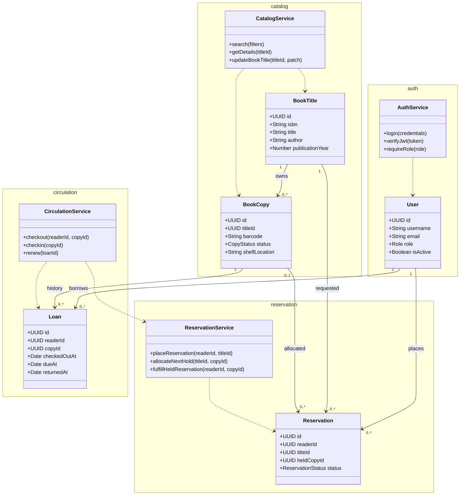

# PA3 §4 — Object-Oriented Design (N1-W1 Draft)

**Project:** UniLib — University Library Management System
**Owner:** Nguyễn Thanh Thảo Nguyên — BA / Frontend (Staff/Admin)
**Scope:** F01–F07, UC-01–UC-12. **Status:** Draft for architectural review, not a final PA3 baseline.

## 4.1 Domain Model

**Editable diagram:** [domain-model.puml](../design/uml/domain-model.puml).

### Entities and relationships

| Concept | Source of truth | Cardinality / constraint |
|---|---|---|
| User / Reader / Librarian / Administrator | Single `users` table; `role` enum | Roles are *logical specializations*, not separate database tables. |
| BookTitle–BookCopy | `book_copies.title_id -> book_titles.id` | One title to zero or many copies; each copy has exactly one title. |
| Reader–Loan | `loans.reader_id -> users.id` | One Reader to zero or many historical loans; each loan has one Reader. |
| BookCopy–Loan | `loans.copy_id -> book_copies.id` | One copy to zero or many historical loans; no simultaneous active loans for one copy. |
| Reader–Reservation | `reservations.reader_id -> users.id` | One Reader to zero or many historical holds; at most two active holds (BR-06). |
| BookTitle–Reservation | `reservations.title_id -> book_titles.id` | One title to zero or many reservation history records. |
| BookCopy–Reservation | Nullable `reservations.held_copy_id` | Each hold refers to zero or one allocated copy; a copy can appear in historical reservations; not multiple concurrent active holds. |

**State conventions:** `Role = Reader | Librarian | Administrator`; `CopyStatus = Available | Borrowed | Reserved | Damaged | Lost`; `ReservationStatus = Pending | Ready | Fulfilled | Cancelled | Expired`. `Overdue` is derived from `dueAt` and `returnedAt` rather than stored as an enum. The actual Q1 database has five tables: `users`, `book_titles`, `book_copies`, `loans`, `reservations`.

**PA2 business rules preserved:** Maximum 3 active Loans (BR-01), 14-day checkout (BR-02), one eligible renewal (BR-03), overdue restrictions (BR-04), zero Available copies required for Reservation (BR-05), maximum 2 active Reservations (BR-06), FIFO (BR-07), 72-hour Pickup Window (BR-08), referential/deletion safety (BR-09), role separation (BR-10).

## 4.2 Class Diagram — Initial Design Draft

The diagram below is a **draft class-level decomposition** for PA3, not a claim that corresponding database tables or JavaScript classes already exist. The actual Prisma entity models remain those in Q1.

**Boundary between components:** React/Vite calls the HTTP API using `client.js` and `endpoints.js`; Express controllers and services own authentication, authorisation, transactions and business rule enforcement. The browser does not query Prisma or PostgreSQL directly. `ReservationService.allocateNextHold()` and `fulfillHeldReservation()` are backend responsibilities; the frontend only consumes corresponding API outcomes.

### Mapping to Q1 ERD

| Design concept | Q1 table | Important mapping |
|---|---|---|
| User + three roles | `users` | `id`, `role`, `is_active`; one user table |
| BookTitle | `book_titles` | `isbn`, `publication_year`, `is_active` |
| BookCopy | `book_copies` | `title_id`, `barcode`, `shelf_location`, `status` |
| Loan | `loans` | `reader_id`, `copy_id`, `checked_out_at`, `due_at`, `returned_at`, `renewed_at` |
| Reservation | `reservations` | `reader_id`, `title_id`, `held_copy_id`, `ready_at`, `expires_at`, status |

### Review dependencies and unresolved decisions

- [ ] Quân to approve exact ERD relationship notation and diagram multiplicities, especially historic `heldCopyId` relationships.
- [ ] Vinh to confirm F01/F05/F07 endpoint paths and response envelopes before production API mode.
- [ ] Confirm `AGENTS.md` and `.github/copilot-instructions.md` code conventions in current repository.
- [ ] Integrate class operations with the final PA3 sequence diagrams and 6–8 class specifications.

**N1 scope note:** Section 4.3 class specifications, 4.4 sequence diagrams and 4.5 state machines are not claimed as completed by this draft.

## 4.3 Class Specifications — N2-W1 Draft

**Status:** Design draft. The entity attributes below are traced to Quân's W1 DBML. A service operation marked **Proposed / verify** is not asserted to exist in the backend; no class method should be presented as implemented until Vinh/Quân review the actual service source. In Prisma, entities are data models rather than necessarily JavaScript classes.

### C1 — User (auth)
**Responsibility:** Represents an account and its single active RBAC role. Reader, Librarian and Administrator are role values in `users.role`, not separate database tables.

| Attribute | Type | Visibility | Constraint | Description |
|---|---|---|---|---|
| id | UUID | public | PK | Account identity |
| username | String | public | UNIQUE, required | Sign-in name |
| email | String | public | UNIQUE, required | Contact address |
| fullName | String | public | Required | Account display name |
| passwordHash | String | private | Required | Server-only bcrypt hash, never exposed in client mock |
| role | Role | public | Reader / Librarian / Administrator | Authorized role |
| isActive | Boolean | public | Required | Account lifecycle flag |

| Operation | Parameters / Return | Visibility | Description / verification |
|---|---|---|---|
| createUser | userData → User | service-side | Proposed / verify with Vinh's F01 service; admin workflow UC-02 |
| updateUser | userId, patch → User | service-side | Proposed / verify; role/active updates only for Administrator |

### C2 — BookTitle (catalog)
**Responsibility:** Holds bibliographic metadata and aggregates availability of Book Copies.

| Attribute | Type | Visibility | Constraint | Description |
|---|---|---|---|---|
| id | UUID | public | PK | Title identifier |
| isbn | String | public | UNIQUE, required | Published work identifier |
| title | String | public | Required | Work title |
| author | String | public | Required | Author(s), one string in Q1 schema |
| category | String | public | Required | Category |
| publisher | String? | public | Optional | Publisher |
| publicationYear | Integer | public | Required | Publication year |
| isActive | Boolean | public | Required | Catalog availability flag |

| Operation | Parameters / Return | Visibility | Description / verification |
|---|---|---|---|
| createTitle | metadata → BookDetail | service-side | Proposed / verify with Quân; implemented external REST contract: POST /api/books |
| updateTitle | titleId, patch → BookDetail | service-side | Proposed / verify; REST: PATCH /api/books/:id |
| deactivateTitle | titleId → BookDetail | service-side | Proposed / verify; REST DELETE /api/books/:id enforces BR-09 |

### C3 — BookCopy (catalog)
**Responsibility:** Represents one physical unit and its inventory lifecycle.

| Attribute | Type | Visibility | Constraint | Description |
|---|---|---|---|---|
| id | UUID | public | PK | Copy identifier |
| titleId | UUID | public | FK, required | Parent BookTitle |
| barcode | String | public | UNIQUE, required | Virtual/manual copy ID (not RFID scanner) |
| shelfLocation | String | public | Required | Physical shelf |
| conditionNotes | String? | public | Optional | Physical condition |
| status | CopyStatus | public | Available, Borrowed, Reserved, Damaged, Lost | Lifecycle |

| Operation | Parameters / Return | Visibility | Description / verification |
|---|---|---|---|
| registerCopy | titleId, copyData → Copy | service-side | Proposed / verify; REST: POST /api/books/:id/copies |
| updateCopy | copyId, patch → Copy | service-side | Proposed / verify; REST: PATCH /api/copies/:id |
| decommissionCopy | copyId → void | service-side | Proposed / verify; REST: DELETE /api/copies/:id with BR-09 checks |

### C4 — Loan (circulation)
**Responsibility:** Stores a Reader's checkout and eventual return of one physical Book Copy. Overdue is computed dynamically from `dueAt`, `returnedAt` and current time.

| Attribute | Type | Visibility | Constraint | Description |
|---|---|---|---|---|
| id | UUID | public | PK | Loan identifier |
| readerId | UUID | public | FK → User | Borrower |
| copyId | UUID | public | FK → BookCopy | Circulating copy |
| checkedOutAt | DateTime | public | Required | Checkout timestamp |
| dueAt | DateTime | public | Required | 14-day due date |
| returnedAt | DateTime? | public | Optional | Return completion |
| renewedAt | DateTime? | public | Optional | One-time renewal record |

| Operation | Parameters / Return | Visibility | Description / verification |
|---|---|---|---|
| isOverdue | now → Boolean | derived | Design computation: returnedAt is null and dueAt precedes current date/time; verify calendar-day semantics against BR-04 |

### C5 — Reservation (reservation)
**Responsibility:** Captures a Reader's title-level FIFO hold and optional allocated physical copy.

| Attribute | Type | Visibility | Constraint | Description |
|---|---|---|---|---|
| id | UUID | public | PK | Hold identifier |
| readerId | UUID | public | FK → User | Requesting Reader |
| titleId | UUID | public | FK → BookTitle | Requested title |
| heldCopyId | UUID? | public | Nullable FK → BookCopy | Allocated copy, if Ready |
| status | ReservationStatus | public | Pending/Ready/Fulfilled/Cancelled/Expired | Reservation state |
| createdAt | DateTime | public | Required | FIFO ordering, tie-break by ID |
| readyAt | DateTime? | public | Optional | Allocation time |
| expiresAt | DateTime? | public | Optional | Ready window ends 72 h later |
| fulfilledAt | DateTime? | public | Optional | Hold checkout time |
| cancelledAt | DateTime? | public | Optional | Cancellation time |

| Operation | Parameters / Return | Visibility | Description / verification |
|---|---|---|---|
| queuePosition | reservations → Integer | derived | Pending position is 1-based; Ready/history = 0 (confirmed API contract) |

### C6 — AuthService (auth)
**Responsibility:** Authenticates users and enforces JWT/RBAC for protected API operations.

| Attribute | Type | Visibility | Constraint | Description |
|---|---|---|---|---|
| jwtSecret | String | private | Backend environment only | Never exposed in SPA |

| Operation | Parameters / Return | Visibility | Description / verification |
|---|---|---|---|
| login | credentials → JWT/session | service | Proposed / verify with Vinh's F01 code |
| verifyJwt | token → claims | service | Proposed / verify: `sub` + `role` claims (confirmed contract) |
| requireRole | user, role → authorization result | service | Proposed / verify; missing JWT 401, forbidden role 403 |

### C7 — LoanService (circulation)
**Responsibility:** Executes checkout, return, and renewal under BR-01 through BR-04, coordinating allocated holds atomically.

| Attribute | Type | Visibility | Constraint | Description |
|---|---|---|---|---|
| prisma | PrismaClient | private | Injected transaction access | Server-owned data persistence |

| Operation | Parameters / Return | Visibility | Description / verification |
|---|---|---|---|---|
| checkout | readerId, copyId → Loan | service | Proposed / verify with Vinh; eligibility + 14-day due date |
| checkin | copyId, condition → return result | service | Proposed / verify with Vinh; coordinate allocation in same transaction |
| renew | loanId → Loan | service | Proposed / verify with Vinh; at most one eligible renewal |

### C8 — ReservationService (reservation)
**Responsibility:** Maintains FIFO reservations and ensures allocation/fulfillment in safe database transactions.

| Attribute | Type | Visibility | Constraint | Description |
|---|---|---|---|---|
| prisma | PrismaClient | private | Transaction-aware | PostgreSQL 16 / Prisma integration |

| Operation | Parameters / Return | Visibility | Description / verification |
|---|---|---|---|---|
| placeReservation | readerId, titleId → reservation,queuePosition | service | Named in Quân's reservation sequence diagram; verify actual export |
| allocateNextHold | tx, titleId, copyId, now → allocation | service | **Confirmed named integration export** in W1 API contract |
| fulfillHeldReservation | tx, readerId, copyId, now → fulfillment | service | **Confirmed named integration export** in W1 API contract |

### 4.3.9 Traceability and Review Notes

| Screen | Use Case | Primary entities/services | Verified contract |
|---|---|---|---|
| SCR-02 | UC-02 | User, AuthService | F01 endpoints **provisional until Vinh confirmation** |
| SCR-03 | UC-03 | BookTitle, BookCopy | POST/PATCH/DELETE /api/books (Quân confirmed) |
| SCR-04 | UC-04 | BookCopy | GET/POST /api/books/:id/copies; PATCH/DELETE /api/copies/:id (Quân confirmed) |

**Design caveats:** F01 `api.users.*` is provisional in the N1 API adapter. The UI's Authors field maps to the Q1 schema's single `author` string (not a separate authors table). The physical scanner remains out of scope. Account password management, status transition enforcement and atomic circulation decisions remain on the backend. Exact backend method names in C1–C7 require review of source before final baseline.
