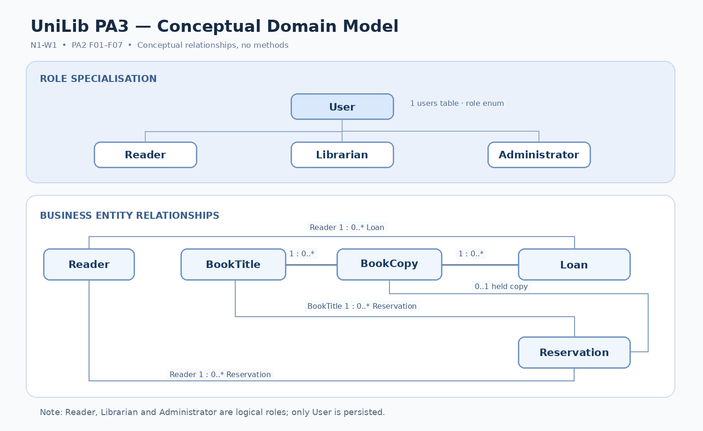
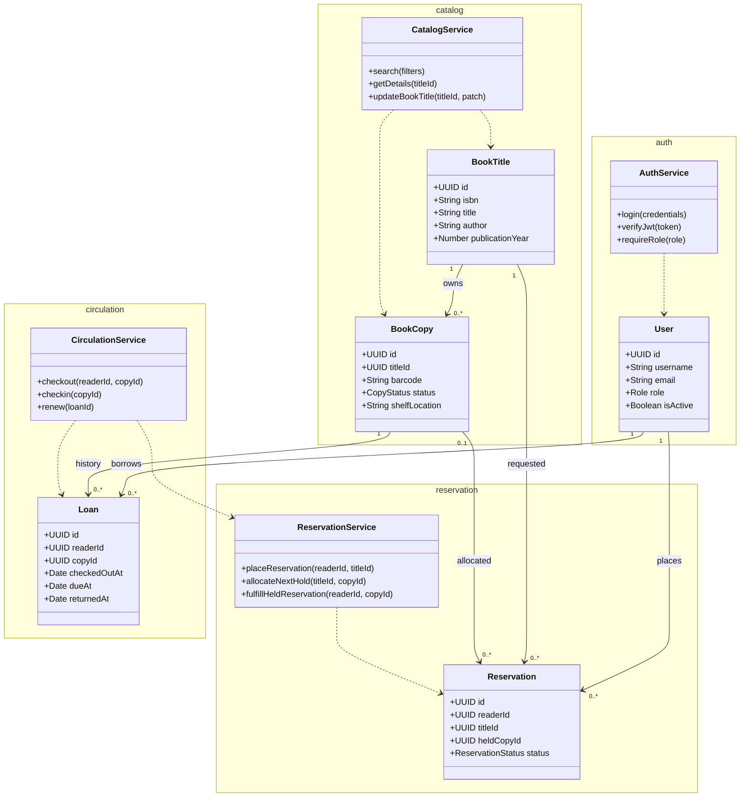

# PA3 §4 — Object-Oriented Design (N1-W1 Draft)

**Project:** UniLib — University Library Management System
**Owner:** Nguyễn Thanh Thảo Nguyên — BA / Frontend (Staff/Admin)
**Scope:** F01–F07, UC-01–UC-12. **Status:** Draft for architectural review, not a final PA3 baseline.

## 4.1 Domain Model

**Editable diagram:** [domain-model.puml](../design/uml/domain-model.puml).

### Entities and relationships

| Concept | Source of truth | Cardinality / constraint |
|---|---|---|
| User / Reader / Librarian / Administrator | Single `users` table; `role` enum | Roles are *logical specializations*, not separate database tables. |
| BookTitle–BookCopy | `book_copies.title_id -> book_titles.id` | One title to zero or many copies; each copy has exactly one title. |
| Reader–Loan | `loans.reader_id -> users.id` | One Reader to zero or many historical loans; each loan has one Reader. |
| BookCopy–Loan | `loans.copy_id -> book_copies.id` | One copy to zero or many historical loans; no simultaneous active loans for one copy. |
| Reader–Reservation | `reservations.reader_id -> users.id` | One Reader to zero or many historical holds; at most two active holds (BR-06). |
| BookTitle–Reservation | `reservations.title_id -> book_titles.id` | One title to zero or many reservation history records. |
| BookCopy–Reservation | Nullable `reservations.held_copy_id` | Each hold refers to zero or one allocated copy; a copy can appear in historical reservations; not multiple concurrent active holds. |

**State conventions:** `Role = Reader | Librarian | Administrator`; `CopyStatus = Available | Borrowed | Reserved | Damaged | Lost`; `ReservationStatus = Pending | Ready | Fulfilled | Cancelled | Expired`. `Overdue` is derived from `dueAt` and `returnedAt` rather than stored as an enum. The actual Q1 database has five tables: `users`, `book_titles`, `book_copies`, `loans`, `reservations`.

**PA2 business rules preserved:** Maximum 3 active Loans (BR-01), 14-day checkout (BR-02), one eligible renewal (BR-03), overdue restrictions (BR-04), zero Available copies required for Reservation (BR-05), maximum 2 active Reservations (BR-06), FIFO (BR-07), 72-hour Pickup Window (BR-08), referential/deletion safety (BR-09), role separation (BR-10).

## 4.2 Class Diagram — Initial Design Draft

The diagram below is a **draft class-level decomposition** for PA3, not a claim that corresponding database tables or JavaScript classes already exist. The actual Prisma entity models remain those in Q1.

**Boundary between components:** React/Vite calls the HTTP API using `client.js` and `endpoints.js`; Express controllers and services own authentication, authorisation, transactions and business rule enforcement. The browser does not query Prisma or PostgreSQL directly. `ReservationService.allocateNextHold()` and `fulfillHeldReservation()` are backend responsibilities; the frontend only consumes corresponding API outcomes.

### Mapping to Q1 ERD

| Design concept | Q1 table | Important mapping |
|---|---|---|
| User + three roles | `users` | `id`, `role`, `is_active`; one user table |
| BookTitle | `book_titles` | `isbn`, `publication_year`, `is_active` |
| BookCopy | `book_copies` | `title_id`, `barcode`, `shelf_location`, `status` |
| Loan | `loans` | `reader_id`, `copy_id`, `checked_out_at`, `due_at`, `returned_at`, `renewed_at` |
| Reservation | `reservations` | `reader_id`, `title_id`, `held_copy_id`, `ready_at`, `expires_at`, status |

### Review dependencies and unresolved decisions

- [ ] Quân to approve exact ERD relationship notation and diagram multiplicities, especially historic `heldCopyId` relationships.
- [ ] Vinh to confirm F01/F05/F07 endpoint paths and response envelopes before production API mode.
- [ ] Confirm `AGENTS.md` and `.github/copilot-instructions.md` code conventions in current repository.
- [ ] Integrate class operations with the final PA3 sequence diagrams and 6–8 class specifications.

**N1 scope note:** Section 4.3 class specifications, 4.4 sequence diagrams and 4.5 state machines are not claimed as completed by this draft.
