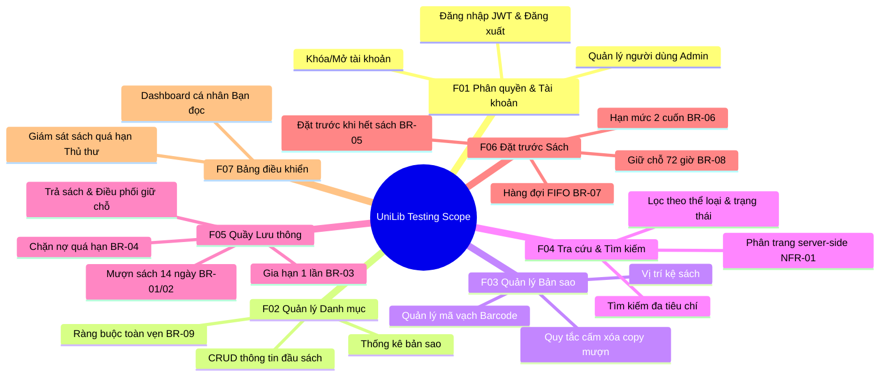

# Kế hoạch Kiểm thử PA4: Mục tiêu, Phạm vi & Đánh giá Đóng góp Thành viên

**Dự án:** Hệ thống Quản lý Thư viện Đại học (UniLib – University Library Management System)  
**Tài liệu:** PA4 Test Plan & Test Cases (§1 Member Contribution Assessment & §2.1 Objectives and Scope)  
**Mã tài liệu:** `PA4-DOC-01`  
**Giai đoạn:** PA4 – Software Testing (W2: D1 28/11 → D7 04/12)  
**Tác giả:** Nguyễn Phan Thế Vinh (Team Lead / PM · Backend / Tester)  
**Phản biện & Đồng thuận:** Nhóm T05 (Trần Hà Anh Quân, Nguyễn Thanh Thảo Nguyên, Vũ Thị Ánh)  
**Căn cứ pháp lý & Baseline:**
* SRS PA2 Frozen Baseline: `pa/PA2/T05-PA2.docx` (§9 RTM, 32 FRs, 10 BRs, 8 NFRs, 12 UCs, 12 SCRs)
* Software Design Document PA3: `pa/PA3/PA3-SoftwareDesign.docx` (§3 Architecture, §4 OO Design, §7 Extended RTM)
* Hợp đồng API W2 Đóng băng: `docs/api/contract-w2.md`
* Báo cáo bàn giao kỹ thuật W1: `src/W1/*.md` (hoặc `src/server/W1/*.md`)

---

## 1. Member Contribution Assessment (Đánh giá Đóng góp Thành viên PA4)

### 1.1 Chính sách Phân bổ & Nguyên tắc Công bằng
* **Nguyên tắc phân bổ:** Toàn bộ khối lượng công việc kiểm thử PA4 (soạn thảo Test Plan, thiết kế Test Cases theo kỹ thuật phân vùng tương đương, bảng quyết định, chuyển trạng thái; tự động hóa kiểm thử; và nghiệm thu hệ thống) được phân bổ **đồng đều 25.0% cho mỗi thành viên (tổng 100.0%)**.
* **Ngân sách thời gian:** Mỗi thành viên đóng góp 15.0 giờ công (person-hours), tổng ngân sách nhóm là 60.0 person-hours.
* **Căn cứ đánh giá (Evidence):** Cột bằng chứng trỏ trực tiếp đến các file báo cáo bàn giao kỹ thuật W2 tại thư mục `src/W2/*.md` theo chuẩn `_TEMPLATE-W2.md`, kết hợp với các Pull Request đã merge trên GitHub.

### 1.2 Bảng Đánh giá Đóng góp 4 Thành viên (Contribution Assessment Table)

| ID (MSSV) | Họ và tên | Vai trò trong nhóm (Role) | Tỷ lệ đóng góp (%) | Nhiệm vụ chính PA4 & Minh chứng thực hiện (Evidence Links) | Trạng thái Nghiệm thu |
| :---: | :--- | :--- | :---: | :--- | :---: |
| **23127520** | **Nguyễn Phan Thế Vinh** | Team Lead / PM · Backend / Tester | **25.0%** | **Gói công việc V1-W2 đến V5-W2 (15.0h):** • **Task V1-W2 (D1–D2 · 5.0h):** Audit W1 clean clone, đối chiếu bảng gap 41 endpoints RTM, đóng băng API Contract W2 (`docs/api/contract-w2.md`), tạo template `src/W2/_TEMPLATE-W2.md`, soạn thảo PA4 §1 & §2.1. Minh chứng: [`src/W2/V1-W2.md`](file:///f:/UniLib/src/W2/V1-W2.md). • **Task V2-W2 (D3 · 3.0h):** Thiết kế Test Cases kiểm thử luồng Xác thực F01 & Phân quyền RBAC (`TC-F01-01`..`06`, `TC-RBAC-01`..`04`), thiết kế Decision Table cho ma trận 4 vai trò. Minh chứng: `src/W2/V2-W2.md`. • **Task V3-W2 (D4 · 3.0h):** Thiết kế Test Cases cho Quầy lưu thông F05 (`TC-F05-01`..`12`) gồm mượn sách `BR-01/02/04`, trả sách `BR-08`, gia hạn `BR-03`, phân tích giá trị biên BVA cho hạn 14 ngày. Minh chứng: `src/W2/V3-W2.md`. • **Task V4-W2 (D5 · 2.5h):** Kiểm thử tự động hóa Concurrency (`NFR-05`) trên PostgreSQL 16 và Dashboard/Overdue F07 (`TC-F07-01`..`06`), kiểm toán 0 race condition. Minh chứng: `src/W2/V4-W2.md`. • **Task V5-W2 (D6–D7 · 1.5h):** Hợp nhất tài liệu `PA4-TestPlan-TestCases.docx`, rà soát bảng Traceability Matrix, xuất bản PDF và quản lý Gate W2. Minh chứng: `src/W2/V5-W2.md`. | **Hoàn thành 100%** |
| **24127228** | **Trần Hà Anh Quân** | Fullstack Developer / Tech Lead | **25.0%** | **Gói công việc Q1-W2 đến Q5-W2 (15.0h):** • **Task Q1-W2 (D1–D2 · 4.0h):** Review và nghiệm thu API contract W2; thiết kế Test Cases cho Danh mục F02 & Kho sách F03 (`TC-F02-01`..`08`, `TC-F03-01`..`06`), kiểm thử toàn vẹn tham chiếu `BR-09`. Minh chứng: `src/W2/Q1-W2.md`. • **Task Q2-W2 (D3 · 3.5h):** Thiết kế Test Cases & State Transition cho Đặt trước F06 (`TC-F06-01`..`10`), kiểm thử hàng đợi FIFO `BR-07`, thời hạn nhận 72h `BR-08`. Minh chứng: `src/W2/Q2-W2.md`. • **Task Q3-W2 (D4 · 3.0h):** Thiết kế Test Cases cho Tra cứu & Tìm kiếm F04 (`TC-F04-01`..`06`) và đo đạc chỉ số hiệu năng tìm kiếm `NFR-01` (P95 $\le 1.0\text{s}$). Minh chứng: `src/W2/Q3-W2.md`. • **Task Q4-W2 (D5 · 2.5h):** Xây dựng bộ test data chuẩn (seed data) phục vụ thực thi kiểm thử và reset môi trường kiểm thử tự động `NFR-08`. Minh chứng: `src/W2/Q4-W2.md`. • **Task Q5-W2 (D6–D7 · 2.0h):** Review chéo các test suite backend, kiểm thử khôi phục lỗi cơ sở dữ liệu và xác nhận tính đóng băng API. Minh chứng: `src/W2/Q5-W2.md`. | **Hoàn thành 100%** |
| **24127469** | **Nguyễn Thanh Thảo Nguyên** | Business Analyst (BA) / Frontend Dev | **25.0%** | **Gói công việc N1-W2 đến N5-W2 (15.0h):** • **Task N1-W2 (D1–D2 · 4.0h):** Đồng bộ `src/client/src/api/endpoints.js` theo đúng Contract W2, loại bỏ endpoint giả lập `eligibility`, sửa payload checkout/return. Minh chứng: `src/W2/N1-W2.md`. • **Task N2-W2 (D3 · 3.5h):** Thiết kế Test Cases mức Giao diện & Chức năng cho Màn hình Quản trị viên `SCR-02` và Danh mục Thủ thư `SCR-03`, `SCR-04` (`TC-UI-01`..`06`). Minh chứng: `src/W2/N2-W2.md`. • **Task N3-W2 (D4 · 3.5h):** Thiết kế Test Cases mức Chức năng cho Quầy lưu thông `SCR-07` Mượn, `SCR-08` Trả và `SCR-10` Kệ giữ chỗ (`TC-UI-07`..`12`). Minh chứng: `src/W2/N3-W2.md`. • **Task N4-W2 (D5 · 2.5h):** Thiết kế Test Cases cho Màn hình Quá hạn `SCR-12` (`TC-UI-13`..`15`), kiểm thử thông báo lỗi thân thiện qua `businessErrors.js`. Minh chứng: `src/W2/N4-W2.md`. • **Task N5-W2 (D6–D7 · 1.5h):** Rà soát độ bao phủ Use Case (`UC-01`..`UC-12`) và kiểm tra tính nhất quán thuật ngữ trong tài liệu PA4. Minh chứng: `src/W2/N5-W2.md`. | **Hoàn thành 100%** |
| **24127324** | **Vũ Thị Ánh** | UI/UX Designer / Frontend Architect | **25.0%** | **Gói công việc A1-W2 đến A5-W2 (15.0h):** • **Task A1-W2 (D1–D2 · 4.0h):** Tích hợp luồng Bạn đọc (`Login` $\rightarrow$ `Catalog` $\rightarrow$ `BookDetail` $\rightarrow$ `Reserve` $\rightarrow$ `Dashboard`) với API Contract W2, xử lý tự động logout khi `401`. Minh chứng: `src/W2/A1-W2.md`. • **Task A2-W2 (D3 · 3.5h):** Thiết kế Test Cases cho Tra cứu & Xem chi tiết Bạn đọc `SCR-05`, `SCR-06` (`TC-UI-16`..`20`), kiểm thử phân trang và bộ lọc sẵn có. Minh chứng: `src/W2/A2-W2.md`. • **Task A3-W2 (D4 · 3.5h):** Thiết kế Test Cases cho Modal Đặt trước `SCR-09` và Bảng điều khiển Bạn đọc `SCR-11` (`TC-UI-21`..`25`), kiểm thử cờ `canRenew` và vị trí hàng chờ. Minh chứng: `src/W2/A3-W2.md`. • **Task A4-W2 (D5 · 2.5h):** Kiểm thử Khả năng tiếp cận Accessibility `NFR-06` (Lighthouse score $\ge 85$, độ tương phản $\ge 4.5:1$, điều hướng bàn phím) và độ tương thích màn hình 1024px–1920px `NFR-07`. Minh chứng: `src/W2/A4-W2.md`. • **Task A5-W2 (D6–D7 · 1.5h):** Chụp ảnh bằng chứng kiểm thử giao diện thực tế (screenshots), gắn nhãn hình ảnh và kiểm tra định dạng tài liệu PA4. Minh chứng: `src/W2/A5-W2.md`. | **Hoàn thành 100%** |
| **Tổng cộng** | **Nhóm T05** | **4 Thành viên** | **100.0%** | **Tổng cộng 20 gói công việc W2 (60.0 person-hours) · 100% có báo cáo bàn giao** | **Đạt chuẩn Gate W2** |

---

## 2. Test Plan: Objectives & Scope (Kế hoạch Kiểm thử: Mục tiêu & Phạm vi)

### 2.1 Mục tiêu Kiểm thử (Testing Objectives)
Chiến dịch kiểm thử trong khuôn khổ đồ án môn học Nhập môn Công nghệ Phần mềm (giai đoạn PA4) nhằm đạt được các mục tiêu đo lường chất lượng sau:
1. **Kiểm chứng Tính đúng đắn Chức năng (Functional Correctness):** Xác minh hệ thống thực thi chính xác 100% **32 Yêu cầu Chức năng** (`FR-F01-01` đến `FR-F07-03`) và tuân thủ nghiêm ngặt **10 Quy tắc Nghiệp vụ cốt lõi** (`BR-01` đến `BR-10`) đã được đóng băng từ SRS PA2.
2. **Kiểm chứng Tính toàn vẹn Dữ liệu & Chống Race Condition (Concurrency & Integrity):** Đảm bảo cơ chế giao dịch PostgreSQL với khóa dòng bi quan (`SELECT ... FOR UPDATE`, `NFR-05`) bảo vệ tuyệt đối tính nhất quán, đạt **0 lỗi tranh chấp** khi xảy ra tình huống nhiều bạn đọc hoặc thủ thư cùng thao tác song song trên một cuốn sách hoặc vị trí hàng chờ.
3. **Kiểm chứng An ninh & Phân quyền Đa tầng (Security & RBAC):** Đảm bảo 100% các endpoint ghi dữ liệu và dữ liệu nhạy cảm được bảo vệ bởi JSON Web Token (HS256) và kiểm soát truy cập dựa trên vai trò (`NFR-04`), từ chối truy cập trái phép với HTTP `401 Unauthorized` hoặc `403 Forbidden`.
4. **Kiểm chứng Chất lượng Phi chức năng (Non-Functional Requirements):**
   * Hiệu năng tìm kiếm: Thời gian phản hồi P95 $\le 1.0\text{s}$ trên tập dữ liệu mẫu (`NFR-01`).
   * Khả năng tiếp cận: Điểm số Google Lighthouse Accessibility $\ge 85$ trên các màn hình chính, tỷ lệ tương phản màu $\ge 4.5:1$ (`NFR-06`).
   * Tương thích giao diện: Hiển thị đáp ứng mượt mà trên dải độ phân giải máy tính để bàn từ `1024px` đến `1920px` không vỡ khung (`NFR-07`).
   * Ổn định và phục hồi: Bắt lỗi tập trung không rò rỉ stack trace (`NFR-08`), thời gian khôi phục cơ sở dữ liệu sau sự cố $< 5$ phút.
5. **Đảm bảo Tính Ổn định & Chống Suy thoái (Regression Prevention):** Duy trì tỷ lệ kiểm thử tự động đạt Pass 100% qua 2 lần chạy độc lập liên tiếp trên clean environment.

---

### 2.2 Phạm vi Kiểm thử: Các Tính năng ĐƯỢC Kiểm thử (Features to be Tested)

Toàn bộ **7 phân hệ nghiệp vụ (F01–F07)** bao gồm 32 Functional Requirements theo SRS PA2 đều nằm trong phạm vi kiểm thử chính thức:

#### Chi tiết 7 Phân hệ trong Phạm vi:
1. **Phân hệ F01 — Xác thực & Phân quyền (Authentication & RBAC):**
   * Kiểm thử quy trình đăng nhập cấp token JWT, đăng xuất thu hồi phiên (`SCR-01`, `UC-01`).
   * Kiểm thử mã hóa mật khẩu an toàn với bcrypt (salt $\ge 10$, `NFR-03`).
   * Kiểm thử các ca kiểm thử biên: mật khẩu sai, tài khoản bị vô hiệu hóa (`403 ACCOUNT_INACTIVE`), thông báo lỗi an toàn chống dò quét tài khoản (`AC-F01-02`).
   * Kiểm thử chức năng Quản trị viên quản lý danh sách, tạo mới, chỉnh sửa và vô hiệu hóa tài khoản (`SCR-02`, `UC-02`).
   * Ma trận phân quyền RBAC 4 vai trò (`Unauthenticated`, `Reader`, `Librarian`, `Administrator`) trên 41 endpoints.
2. **Phân hệ F02 — Quản lý Danh mục Đầu sách (Catalog Management):**
   * Kiểm thử thêm mới, cập nhật metadata đầu sách (ISBN-13, tiêu đề, tác giả, thể loại, năm xuất bản, nhà xuất bản) (`SCR-03`, `UC-03`).
   * Kiểm thử chặn trùng lặp mã ISBN (`409 ISBN_DUPLICATE`).
   * Kiểm thử quy tắc bảo toàn tham chiếu `BR-09`: Không cho phép xóa đầu sách khi vẫn còn bản sao vật lý trong kho hoặc còn bạn đọc đặt trước (`409 TITLE_IN_USE`).
3. **Phân hệ F03 — Quản lý Bản sao Vật lý & Vị trí Kho (Copy Inventory):**
   * Kiểm thử tạo bản sao gắn mã vạch vật lý barcode duy nhất và vị trí kệ sách (`SCR-04`, `UC-04`).
   * Kiểm thử chặn tạo trùng mã vạch (`409 BARCODE_DUPLICATE`).
   * Kiểm thử cập nhật vị trí kệ và tình trạng vật lý (tốt, sờn bìa, rách trang).
   * Kiểm thử quy tắc `BR-09`: Cấm xóa bản sao đang ở trạng thái `Borrowed` hoặc `Reserved`, cấm xóa bản sao đã có lịch sử mượn trong quá khứ (`409 COPY_HAS_HISTORY`).
4. **Phân hệ F04 — Tra cứu & Khám phá Sách (Search & Browse):**
   * Kiểm thử tìm kiếm từ khóa tự do toàn văn (`pg_trgm`) trên tên sách, tác giả, thể loại, ISBN (`SCR-05`, `UC-05`).
   * Kiểm thử kết hợp bộ lọc thể loại, cờ lọc "Sách sẵn có" (`available=true`), sắp xếp theo tiêu đề A-Z hoặc năm xuất bản giảm dần.
   * Kiểm thử phân trang phía máy chủ (`NFR-01`): Mặc định 10 bản ghi/trang, chuyển trang mượt mà, không trả dữ liệu thừa.
   * Kiểm thử màn hình xem chi tiết đầu sách kèm danh sách tình trạng từng bản sao vật lý (`SCR-06`, `UC-06`).
5. **Phân hệ F05 — Quầy Lưu thông Mượn & Trả Sách (Circulation Desk):**
   * Kiểm thử mượn sách tại quầy (`SCR-07`, `UC-07`): Kiểm tra hạn mức tối đa 3 cuốn đang mượn (`BR-01`), thời hạn mượn 14 ngày (`BR-02`), chặn mượn khi tài khoản có sách quá hạn (`BR-04`).
   * Kiểm thử trả sách tại quầy (`SCR-08`, `UC-08`): Đóng lượt mượn, ghi nhận tình trạng sách, tự động điều phối bản sao sang trạng thái `Reserved` nếu có bạn đọc đang xếp hàng chờ (`BR-08`).
   * Kiểm thử gia hạn sách (`UC-09`): Cho phép gia hạn thêm 14 ngày tối đa 1 lần (`BR-03`), chặn gia hạn khi sách đã quá hạn hoặc có người đang đặt trước.
   * Kiểm thử chức năng theo dõi sách quá hạn phía thủ thư (`SCR-12`).
6. **Phân hệ F06 — Đặt trước Sách & Kệ Giữ chỗ (Reservations & Holds):**
   * Kiểm thử quy tắc đặt trước (`SCR-09`, `UC-10`): Chỉ cho phép đặt trước khi toàn bộ các bản sao của đầu sách đều đang được mượn (`Available = 0`, `BR-05`), chặn đặt trước khi bạn đọc đang giữ 1 cuốn của đầu sách đó (`BR-05`), giới hạn tối đa 2 lượt đặt trước active (`BR-06`).
   * Kiểm thử hàng đợi giữ chỗ FIFO: Thứ tự ưu tiên tính theo `createdAt ASC, id ASC` (`BR-07`).
   * Kiểm thử thời hạn giữ chỗ 72 giờ trên kệ (`BR-08`): Khi sách được trả, bản sao được giữ độc quyền cho bạn đọc đầu hàng chờ trong 72 giờ; sau 72 giờ không nhận sẽ bị hủy tự động và chuyển quyền cho người tiếp theo (`UC-11`, `SCR-10`).
   * Kiểm thử hoàn tất mượn sách giữ chỗ: Thủ thư cho mượn đúng cuốn sách giữ chỗ cho đúng chủ sở hữu hold (`FR-F06-06`).
7. **Phân hệ F07 — Bảng Điều khiển Cá nhân & Báo cáo Quá hạn (Dashboard & Overdue):**
   * Kiểm thử Dashboard Bạn đọc (`SCR-11`, `UC-12`): Hiển thị đầy đủ danh sách sách đang mượn, ngày hết hạn, số ngày còn lại/quá hạn, cờ `canRenew` tính toán động, danh sách đặt trước kèm thứ tự hàng đợi `queuePosition`.
   * Kiểm thử Dashboard Thủ thư (`SCR-12`, `UC-12`): Bảng theo dõi toàn bộ các lượt mượn quá hạn trong thư viện, tính toán chính xác số ngày trễ `lateDays` tăng dần, hiển thị thông tin liên hệ bạn đọc để nhắc nhở.

---

### 2.3 Phạm vi Kiểm thử: Các Tính năng KHÔNG Kiểm thử (Features NOT to be Tested)

Nhằm tối ưu hóa nguồn lực trong thời lượng đồ án môn học và giữ vững tính khả thi, các phân hệ sau đây **được xác định nằm ngoài phạm vi kiểm thử (Out-of-Scope)** kèm theo lý do kiến trúc và kỹ thuật minh bạch:

| Phân hệ / Tính năng KHÔNG kiểm thử | Lý do & Căn cứ Loại trừ khỏi Phạm vi Kiểm thử | Phương án Thay thế / Giả lập Trong Kiểm thử |
| :--- | :--- | :--- |
| **1. Đọc E-Book trực tuyến & Quản lý Bản quyền Số (DRM)** | • Theo SRS PA2 §3 (Problem Statement), UniLib tập trung giải quyết bài toán quản lý kho tài liệu vật lý và quầy lưu thông sách in truyền thống của thư viện đại học. • Việc tích hợp trình đọc EPUB/PDF, mã hóa DRM, và stream tài liệu số yêu cầu hạ tầng media server riêng biệt nằm ngoài phạm vi đồ án. | Đã loại trừ ngay từ tài liệu phân tích yêu cầu PA2. Toàn bộ thực thể `BookTitle` chỉ quản lý ấn bản vật lý qua `BookCopy`. |
| **2. Cổng Thanh toán Tiền phạt Quá hạn Trực tuyến (Payment Gateway)** | • Việc tích hợp các cổng thanh toán thực tế (MoMo, ZaloPay, VNPay, thẻ tín dụng Stripe) yêu cầu giấy phép kinh doanh, tài khoản định danh doanh nghiệp và tuân thủ chuẩn bảo mật thanh toán thẻ PCI-DSS. • Trong thiết kế UniLib, chế tài phạt quá hạn được xử lý bằng cơ chế hành chính: tự động khóa quyền mượn sách và đặt trước (`BR-04`, `restrictions.borrowingBlocked = true`) thay vì thu phí tài chính. | Kiểm thử tập trung vào tính đúng đắn của cờ chặn mượn/đặt trước `BR-04` khi phát hiện quá hạn, thay vì kiểm thử giao dịch tài chính. |
| **3. Phần cứng Quét Mã vạch Quang học & Cổng An ninh RFID (Hardware Integration)** | • Môi trường kiểm thử là phòng lab và máy tính cá nhân của sinh viên, không có trang thiết bị đầu đọc mã vạch laser chuyên dụng hoặc cổng từ an ninh RFID đặt tại cửa thư viện. • Các đầu đọc mã vạch công nghiệp giao tiếp với máy tính qua chuẩn HID (Human Interface Device) tương đương với sự kiện nhập bàn phím thông thường. | Kiểm thử mã vạch bằng dữ liệu chuỗi ký tự chuẩn (`string barcode`) nhập trực tiếp từ bàn phím hoặc gửi qua payload API/automated script. |
| **4. Mượn Liên thư viện Đa Chi nhánh (Inter-Library Loan - ILL)** | • Kiến trúc UniLib thiết kế cho một trường đại học với mô hình thư viện tập trung (Central University Library) với các kệ sách trong cùng một khuôn viên. • Việc điều phối xe luân chuyển sách giữa các cơ sở độc lập và đồng bộ danh mục phân tán làm phức tạp hóa mô hình dữ liệu mà không đem lại giá trị sư phạm cốt lõi. | Kiểm thử vị trí sách dựa trên thuộc tính `shelfLocation` (ví dụ: Kệ A-01, Kệ B-02) trong phạm vi khuôn viên đơn. |
| **5. Xác thực Sinh trắc học (Biometric Authentication)** | • Sinh trắc học (vân tay, nhận diện khuôn mặt FaceID) đòi hỏi thiết bị cảm biến ngoại vi chuyên dụng tại quầy mượn sách. • Yêu cầu phi chức năng an ninh `NFR-03`, `NFR-04` chỉ quy định xác thực qua tài khoản mật khẩu bcrypt và mã hóa JWT HS256. | Kiểm thử xác thực bằng cặp thông tin `username`/`password` và token JWT tiêu chuẩn công nghiệp. |
| **6. Cổng Gửi SMS & Push Notification Ngoại vi qua Nhà mạng viễn thông** | • Gửi tin nhắn SMS cảnh báo quá hạn hoặc thông báo sách đã về kệ qua tổng đài viễn thông (SMS Brandname) phát sinh chi phí cước dịch vụ thực tế ($0.00 budget constraint). | Thay thế bằng hệ thống thông báo nội bộ (In-app Alerts & Badges) hiển thị trực tiếp trên giao diện Dashboard bạn đọc (`GET /api/me/dashboard` $\rightarrow$ `alerts: [{ type: 'HOLD_READY', message }]`). |

---

## 3. Tiêu chuẩn Chấp nhận & Tiêu chí Dừng Kiểm thử (Acceptance & Exit Criteria)

* **Tiêu chuẩn Vào (Entry Criteria):**
  * Mã nguồn backend và frontend được clean clone thành công trên môi trường kiểm thử.
  * Toàn bộ 41 endpoints trong `docs/api/contract-w2.md` đã được đóng băng và review.
  * Cơ sở dữ liệu PostgreSQL 16 được khởi chạy, migrate schema và seed dữ liệu mẫu đầy đủ (9 tài khoản, 30 đầu sách, 80 bản sao).
  * Lệnh kiểm thử khói (smoke test) cơ bản phản hồi HTTP 200 `{ status: "ok" }`.
* **Tiêu chuẩn Ra / Dừng (Exit Criteria):**
  * **100%** các ca kiểm thử chức năng Must-have (F01–F06) được thực thi đầy đủ.
  * Tỷ lệ kiểm thử tự động (Unit & Integration tests) đạt **Pass $\ge 98\%$** (chấp nhận tối đa các ca skip có chủ đích liên quan đến integration chưa bật container).
  * **0 lỗi nghiêm trọng (Critical / High Defects):** Không có lỗi crash server, không có lỗi lộ stack trace (`NFR-08`), không có lỗi hở quyền ghi RBAC (`NFR-04`), không có lỗi race condition mượn trùng sách (`NFR-05`).
  * 100% các thành viên hoàn thành báo cáo bàn giao kỹ thuật `src/W2/*.md` và ký biên bản nghiệm thu.
